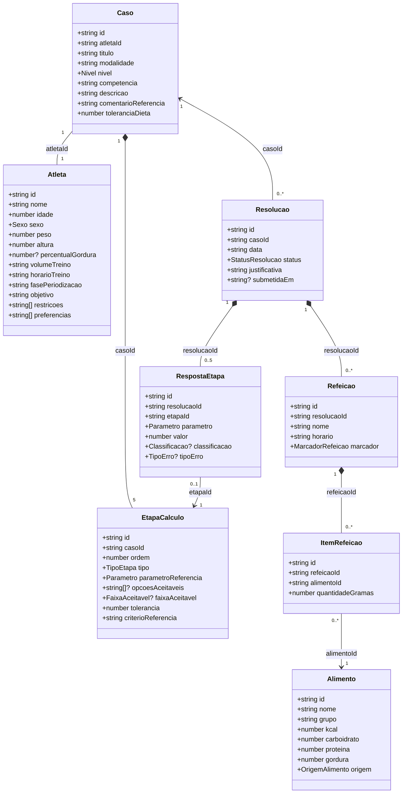

# NutriCase: diagrama de classes

Modelos em `nutricase/src/app/core/models/` (todos os campos são `readonly`; `?` marca campo opcional). A chave que liga uma entidade à outra (`casoId`, `atletaId`, `etapaId`, `resolucaoId`, `refeicaoId`, `alimentoId`) aparece nos atributos e no rótulo da seta.

Valores dos tipos: `Parametro` = string | number (na TMB, o nome da equação; nas outras etapas, um número); `Nivel` = Iniciante | Intermediário | Avançado; `Sexo` = feminino | masculino; `TipoEtapa` = TMB | GET | CHO | PTN | LIP; `FaixaAceitavel` = { min, max }; `StatusResolucao` = em andamento | submetida; `Classificacao` = correta | divergente | erro de fato; `TipoErro` = conversão de unidade | escolha de equação | aritmética | meta fora de faixa | dieta fora das metas; `MarcadorRefeicao` = pré-treino | pós-treino | nenhum; `OrigemAlimento` = TACO | aluno.

## As entidades

O **Caso** é o exercício do catálogo: tem uma ficha de **Atleta** fictício (1 para 1) e exatamente cinco **EtapasCalculo** (TMB, GET, carboidrato, proteína e gordura), que guardam o critério de correção, e ambos são excluídos junto com ele. O estudante faz tentativas, as **Resoluções**: cada uma guarda até uma **RespostaEtapa** por etapa (com a classificação e o tipo de erro, preenchidos só na submissão) e a dieta montada, formada por **Refeições** com seus **ItensRefeição**, cada item apontando para um **Alimento** da base (TACO ou cadastrado pelo aluno). Excluir uma resolução apaga suas respostas, refeições e itens; excluir um caso não apaga as resoluções dele, que continuam guardadas, por isso a seta de Caso para Resolução é uma associação simples e não uma composição. O vínculo do item com o alimento não é uma chave verificada na gravação: um alimento que sumiu da base conta como item incompleto na avaliação.
